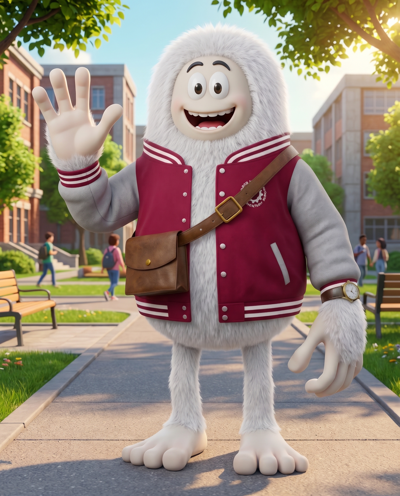
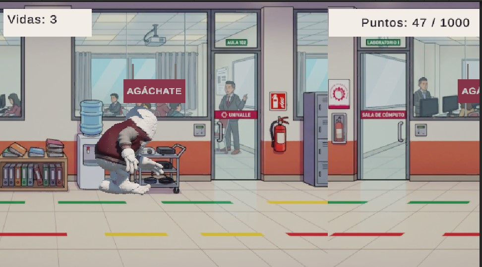

# 🏃‍♂️❄️ ¡Yeti-enes que correr! — Portal Oficial y Juego WebGL



> **Asignatura:** Game Development — Unidad 3 (Portafolio del Juego)  
> **Género:** Arcade / Endless Runner 3D  
> **Motor:** Unity 3D (Compilación WebGL)  
> **Equipo Desarrollador:** Melani Quintela Aguilar & Jose Martin Leaño Mercado  

---

## 🌐 Acceso Directo al Portal y Juego en Vivo

👉 **[Haz clic aquí para abrir el Portal Oficial y Jugar en el Navegador](https://melaniquintelaaguilar.github.io/game-development-portfolio/juegos/07-yetirunner/)**

---

## 📖 Sinopsis e Historia

Un estudiante universitario peludo (tipo Yeti) caminaba confiado hacia el campus con su chamarra guinda y gris pensando que tenía tiempo de sobra. Al mirar su reloj de pulsera en el patio de la universidad, entra en pánico: **¡faltan pocos minutos para que cierren las puertas del laboratorio de Game Development y comience la defensa en vivo!**

El jugador debe guiar al Yeti a toda velocidad a través de los pasillos de la universidad, esquivando obstáculos cotidianos de la vida estudiantil mediante una **narrativa emergente** donde cada partida se genera de forma aleatoria en tiempo real.

---

## 🎮 Controles y Mecánicas Principales

| Entrada / Tecla | Acción en el Juego | Propósito en el Escenario |
| :---: | :--- | :--- |
| **Flecha Arriba (`↑`)** | **Saltar** | Impulsa al Yeti en el aire para superar **obstáculos bajos** (pilas de libros pesados y mochilas en el piso). |
| **Flecha Abajo (`↓`)** | **Agacharse** | Reduce la altura física del personaje para pasar por debajo de **obstáculos altos** (letreros colgantes de *"AGÁCHATE"*). |

### Reglas de la Partida
* **Vidas iniciales:** 3 oportunidades (cada choque contra un obstáculo resta 1 vida).
* **Puntuación por supervivencia:** El puntaje incrementa automáticamente por cada segundo activo en carrera.
* **Condición de Victoria:** Alcanzar los **1000 puntos** (*"¡Meta Alcanzada!"*).
* **Condición de Derrota:** Llegar a **0 vidas** activa la animación de caída y la pantalla de *"Fin de la Partida"*.

---

## 📊 Ficha Técnica del Modelo y Sistema

* **Estilo Visual:** Cartoon 3D Estilizado ambientado en los pasillos interiores y aulas del campus universitario.
* **Topología del Personaje 3D:** 142,362 caras (*Tris*) y 78,770 vértices.
* **Estados de Animación (`Animator`):** 4 clips integrados (*Correr*, *Saltar*, *Agacharse* y *Morir*).
* **Generación del Escenario:** Aparición aleatoria a intervalos de tiempo variables con limpieza automática de objetos superados.



---

## 📁 Estructura del Proyecto en el Repositorio

```text
07-yetirunner/
├── index.html       # Portal web interactivo (Landing Page con las 7 secciones)
├── styles.css       # Hoja de estilos con diseño adaptable y paleta institucional
├── script.js        # Interactividad UX (simulador de controles, bloqueo de flechas y retos de defensa)
├── README.md        # Documentación técnica del proyecto
└── webgl/           # Compilación oficial exportada desde Unity WebGL
    ├── Build/
    ├── TemplateData/
    └── index.html